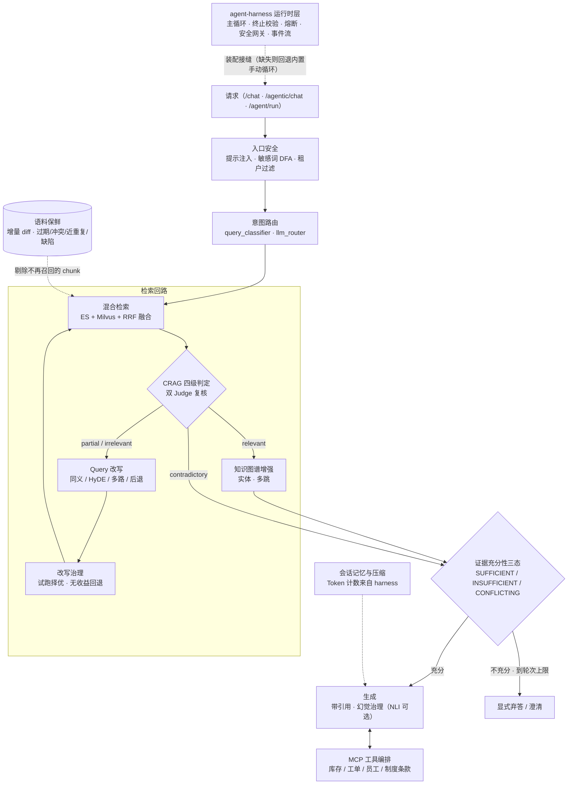

# agentic-rag

**私有文档 Agentic-RAG · AI 服务层** · 个人项目（仅自测），负责 AI 服务层

> 一句话：把"检索到证据"和"可以有把握地回答"做成**两件不同的事**，
> 并且在证据不够、证据互相矛盾、或语料本身已经过期时，**让系统知道停下来**。
>
> 运行时层（主循环 / 终止校验 / 熔断 / 安全网关 / 事件流）在
> [`agent-harness`](https://github.com/nengyong-liang/agent-harness)，本仓通过接口依赖它。

---

## 目录

- [它解决什么](#它解决什么)
- [架构](#架构)
- [核心机制清单](#核心机制清单)
- [快速开始](#快速开始)
- [API 一览](#api-一览)
- [MCP 工具侧](#mcp-工具侧)
- [实验证据](#实验证据)
- [目录结构](#目录结构)
- [配置](#配置)
- [边界：这个项目不声称什么](#边界这个项目不声称什么)

---

## 它解决什么

私有文档问答在生产上的失败方式**不是"检索不到"**，而是这四种，本仓逐个给机制：

| 失败方式 | 现象 | 本仓机制 | 落点 |
|---|---|---|---|
| **检索到了还硬答** | 证据只覆盖问题的一半，模型把剩下的补圆 | **证据充分性三态判定**：`SUFFICIENT` / `INSUFFICIENT` / `CONFLICTING`，规则优先、**LLM 只可加严**（fail-closed），引用不可核查即作废；`INSUFFICIENT` 到轮次上限 → 显式弃答或澄清 | `agent/sufficiency_judge.py` |
| **改写越改越偏** | 多路改写把问题换成了另一个问题 | **改写治理**：试跑择优、**无收益回退原 Query**、意图偏移度量与超限剪枝（HyDE 长文本不因篇幅误判）、按策略归因命中率与回退率 | `rag/rewrite_governor.py` |
| **证据质量不可控** | 一次判定说了算，裁判本身会妥协 | **CRAG 四级判定**（`relevant`/`partial`/`irrelevant`/`contradictory`）+ DeepSeek/Qwen **双 Judge** 复核 + 降级规则打分；矛盾走标记而非择一 | `rag/crag.py` |
| **语料跑半年就脏了** | 旧版本没下线、同一事实两个数值、近重复刷屏 | **Corpus 侧保鲜**：增量索引 diff（只碰变化部分）、5 类发现（过期/被取代/冲突/近重复/缺陷）、4 类处置建议，检索侧按结论剔除。**只读、只标记、不删数据** | `rag/corpus_governance.py` |

另外两条是服务层的通用要求：意图路由与降级（`rag/llm_router.py` `utils/degradation.py`）、
输入侧安全（提示注入检测、DFA 敏感词、租户隔离：`utils/prompt_injection.py`
`utils/dfa_filter.py` `utils/tenant_filter.py`）。

---

## 架构



⚠️ 图上有一条**必须说清的接缝**：`HARNESS` 到本仓是**导入期硬依赖**
（Provider / 可观测 / 上下文计数），**只有执行循环**在缺失时回退到内置手动循环。
细节见 [`docs/KNOWN-ISSUES.md §3`](docs/KNOWN-ISSUES.md)。

---

## 核心机制清单

| 能力 | 模块 | 状态 |
|---|---|---|
| CRAG 四级判定 + 双 Judge 复核 + 降级规则打分 | `rag/crag.py`（LangGraph 条件边） | ✅ |
| 证据充分性三态判定（fail-closed） | `agent/sufficiency_judge.py` + `agent/agentic_rag.py` 的 Validator/Supervisor/Synthesizer | ✅ |
| Query 改写治理（回退原 Query + 意图偏移归因） | `rag/rewrite_governor.py` `rag/query_rewriter.py` | ✅ |
| 混合检索 + RRF 融合 + 动态 top-k | `rag/retriever.py` `rag/fusion.py` | ✅ |
| 知识图谱增强与多跳 | `rag/knowledge_graph.py` | 🟡 |
| 文档解析（PDF 版面 / Word / 切片 / 入仓门禁） | `rag/pdf_*` `rag/word_parser.py` `rag/chunker.py` `utils/quality_gate.py` | ✅ |
| 语料保鲜治理（增量 diff + 5 类发现 + 4 类处置） | `rag/corpus_governance.py` | 🟡 冲突裁决仍靠人工 |
| Query 侧漂移控制（一致性 + 分数阈值） | `rag/drift_controller.py` | ✅ |
| 意图路由 / 成本路由 / 降级与背压 | `rag/llm_router.py` `rag/query_classifier.py` `utils/model_router.py` `utils/degradation.py` | ✅ |
| 自研 JSON-RPC 2.0 MCP Server（不用 MCP SDK） | `mcp_server/` | ✅（见[下节](#mcp-工具侧)） |
| Function Calling 工具桥 + 任务级授权 + HITL 审批 | `agent/mcp_bridge.py` | ✅ |
| 会话记忆、压缩与长任务 | `agent/memory.py` `agent/long_running_task.py` | 🟡 |
| 技能注册与 A2A 适配 | `agent/skill_manager.py` `agent/a2a_adapter.py` | 🟡 |
| 入口安全（提示注入 / DFA 敏感词 / 租户隔离） | `utils/prompt_injection.py` `utils/dfa_filter.py` `utils/sensitive_filter.py` `utils/tenant_filter.py` | ✅ |
| 评测与监控端点（延迟分位 / 健康度 / 基准任务 / 消融） | `api/routes/monitor.py` `rag/rag_evaluator.py` | 🟡 |
| 微调数据合成 / vLLM 推理服务 | `data_synthesis/` `inference/` | 🟡 端点保留，未在公开环境验证 |

✅ 已实现并有回归用例 · 🟡 已实现但有明确未闭合项（`docs/KNOWN-ISSUES.md §12.3`）

---

## 快速开始

### 1. 两仓并列安装（推荐）

```bash
# 目录形态：
#   workspaces/agent-harness/     ← 运行时层
#   workspaces/agentic-rag/       ← 本仓
git clone https://github.com/nengyong-liang/agent-harness.git
git clone https://github.com/nengyong-liang/agentic-rag.git

pip install -e ./agent-harness
pip install -e "./agentic-rag[embeddings]"     # 首次运行需下载 bge-m3 / bge-reranker 权重
```

也可以只装本仓：`pip install -e .[runtime]` 会从 GitHub 拉 harness。

### 2. 零计费自检（不需要 ES / Milvus / Redis，不联网）

```bash
cd agentic-rag
pytest -q
#  → 185 passed（无需设 PYTHONPATH；conftest 会做兄弟目录发现与收集期护栏）

python examples/01_corpus_governance.py     # 语料保鲜：增量 diff + 过期/冲突/近重复发现
python examples/02_evidence_sufficiency.py  # 证据不足时系统怎么答（三态判定）
python examples/03_harness_seam.py          # 装配 harness 成功 / 摘掉它之后回退手动循环
```

### 3. 起服务（需要本地基础设施）

```bash
cp .env.example .env        # 至少填一家底座 KEY
# 依赖：Elasticsearch 8.x + Milvus 2.4.x + Redis 7（默认 localhost，见 .env.example）
python -m agentic_rag.api.main          # 默认 0.0.0.0:8001，GET /health 探活
```

仓库自带两份可直接入库的样例文档：`data/samples/policy.md`（制度条款）、
`data/samples/product_manual.md`（产品手册）。
真实服务栈端到端（上传 → 解析 → 入库 → 问答）**未在公开环境演练过**，
登记在 `docs/EVIDENCE.md §6`。

---

## API 一览

FastAPI，路由集中在 `api/routes/`（`/health` 为进程级探活）：

| 分组 | 代表端点 |
|---|---|
| 问答 | `POST /chat` · `POST /agentic/chat` · `POST /agent/run` · `GET /agent/tools` |
| 文档与入库 | `POST /document/upload` · `POST /document/process` · `DELETE /document/{id}` · `POST /quality/gate` |
| 检索与知识 | `POST /retriever/search` · `GET /kg/entity` · `POST /kg/extract` · `POST /kg/multi_hop` |
| 语料生命周期 | `POST /lifecycle/decay` · `POST /lifecycle/apply_decay` · `POST /lifecycle/filter` |
| 评测与观测 | `POST /eval/single` · `GET /eval/benchmark/summary` · `POST /eval/reliability` · `POST /evaluation/run` · `POST /evaluation/ablation` · `GET /monitor/percentiles` · `GET /monitor/latency_budget` |
| 记忆 | `GET /memory/stats` · `POST /memory/clear` |
| 安全与治理 | `POST /security/check_injection` · `/security/sanitize` · `/security/mask_pii` · `/security/restore_pii` · `/security/nli_check` · `/tenant/filter` · `/semantic/dedup` |
| HITL 审批 | `GET /agent/hitl/pending` · `POST /agent/hitl/submit` · `GET /agent/hitl/risk_map` |
| 长任务 | `GET /tasks` · `GET /task/{id}` |
| 推理与降级 | `GET /inference/status` · `GET /degradation/status` · `GET /cache/stats` |

---

## MCP 工具侧

`mcp_server/` 是**自研 JSON-RPC 2.0**实现（不依赖现成 MCP SDK）：
4 个子 Server 聚合为一个 `combined-mcp`，对外单一 `POST /mcp` 端点，
共 **10 个工具 + 8 个资源**。

```bash
python -m agentic_rag.mcp_server.main      # 默认 0.0.0.0:8001（与 AI 服务同端口，同机并跑时任改其一）
python -m agentic_rag.mcp_server.examples  # 两条调用路径：单次工具调用 / 资源读取
```

三条边界（原文见 `mcp_server/README.md`）：

1. **业务后端未随本仓开源** → 没有后端时工具返回**连接错误**，这是边界不是伪装；
2. `MCP_API_KEY` **留空即 fail-closed**（外部调用全部拒绝，启动只打 warning）；
3. 受保护资源需要 `MCP_JWT_TOKEN`。

---

## 实验证据

```bash
python scripts/analysis/retrieval_ablation_report.py
```

从已提交的 8 份产物（`experiments/retrieval/e5_*_report.json`）打印八档检索消融对照表。
数据集：**WixQA（公开）· 6,221 docs · 200 queries**，进程内 numpy cosine + `bge-m3`。

三条能站住的读法（完整口径与禁令在 [`docs/EVIDENCE.md`](docs/EVIDENCE.md)）：

- **"去重层"曾是死代码**：修复前的 `plus_dedup` 档与基线**六项指标逐位相同**
  —— 加了一层等于没加（`docs/KNOWN-ISSUES.md §2.26-E`）。
- **接好线之后它是减分的**：nDCG@10 −0.0235 / −0.0448，Recall@10 −0.0600 / −0.1250
  （候选池 20 / 生产接线池 10 两档）。→ 本仓**不把它包装成优化**（`§2.27`）。
- **明确正向的是 Cross-encoder 重排**：nDCG@10 **+0.0374**、Recall@1 **+0.0709**、
  MRR@10 **+0.0596**，而 Recall@10 持平 → 改的是排序质量，不是召回集合覆盖。

🔴 `+CRAG` 档**没有产物 = 没跑**，因此"CRAG 提升了检索指标"这句话在本仓不成立。

---

## 目录结构

```
agentic-rag/
├── src/agentic_rag/
│   ├── api/             # FastAPI 应用与路由（chat / document / agent / knowledge /
│   │                    #   monitor / security / task / inference / memory）
│   ├── agent/           # Agentic 回路：充分性判定、Supervisor/Validator/Synthesizer、
│   │   │                #   MCP 工具桥、记忆、长任务、技能注册、A2A 适配
│   │   └── skills/      # 技能包
│   ├── rag/             # 检索回路：retriever / fusion / crag / rewrite_governor /
│   │                    #   query_rewriter / drift_controller / corpus_governance /
│   │                    #   knowledge_graph / chunker / pdf_* / word_parser / llm_router
│   ├── mcp_server/      # 自研 JSON-RPC 2.0 MCP Server（4 子 Server + 客户端 + 示例）
│   ├── utils/           # 底座与安全：ES / Milvus / Redis / embedding / reranker /
│   │                    #   降级 / 生命周期 / 提示注入 / DFA / 敏感词 / 租户过滤 / 质量门禁
│   ├── data_synthesis/  # 微调数据合成
│   ├── inference/       # vLLM 推理服务适配
│   └── execution/       # 任务分发
├── tests/               # 185 条用例（零 API，服务层用假对象注入）
├── examples/            # 3 个可实跑的零 API 样例
├── scripts/analysis/    # 从已提交产物复算 E5 对照表
├── experiments/retrieval/   # 8 份检索消融产物
├── data/samples/        # 两份可直接入库的样例文档
└── docs/
    ├── KNOWN-ISSUES.md  # RAG-01 死代码 · §2.27 负向结论 · 依赖真相 · 缺口表
    └── EVIDENCE.md      # E5 读数、复算命令、未收口项
```

---

## 配置

`.env` 已在 `.gitignore` 内；凭据留空即可跑离线测试。
完整清单见 `.env.example`，关键项：

| 组 | 变量 |
|---|---|
| 服务 | `SERVICE_HOST` · `SERVICE_PORT` · `CORS_ORIGINS` |
| 底座（与 harness 共用同名变量） | `DOUBAO_*` · `QWEN_*`/`ALIBABA_API_KEY` · `DEEPSEEK_*` |
| 存储 | `ES_HOST/ES_PORT/ES_INDEX` · `MILVUS_HOST/PORT/COLLECTION` · `REDIS_HOST/PORT/DB` |
| 模型权重 | `EMBEDDING_MODEL=BAAI/bge-m3` · `RERANK_MODEL=BAAI/bge-reranker-base` |
| 切片与 top-k | `CHUNK_SIZE` · `CHUNK_OVERLAP` · `TOP_K` · `RERANK_TOP_K` |
| 工具侧 | `JAVA_API_URL`（业务后端基址）· `MCP_HOST/PORT/API_KEY/JWT_TOKEN` |
| 可选开关 | `ENABLE_NLI`（幻觉校验）· `ENABLE_MOA`（多模型投票）· `SEARCH_ENGINE` + `SERPAPI_KEY/BING_API_KEY`（联网检索） |
| 观测 | `OTEL_SERVICE_NAME` · `LANGSMITH_*` · `LANGFUSE_*` |

---

## 边界：这个项目不声称什么

- ❌ **不声称检索指标达到 SOTA**。单数据集、单份 qrels、无区间估计；
  BEIR 未下载也未接入主链路（`docs/KNOWN-ISSUES.md §12.3` 缺口 6）。
- ❌ **不声称多样性去重提升了召回**。实测是**负向**（`§2.27`）。
- ❌ **不声称 CRAG 提升了检索指标**。那一档没跑（`docs/EVIDENCE.md §4`）。
- ❌ **不声称可独立运行**。`agent_harness` 是导入期硬依赖（`§3`）。
- ❌ **不与 harness 的 Pass^k / Mean@k 同表比较**。本文指标是**节点级**
  （分母 = 200 条 query），那边是**任务级**（分母 = 19 个任务），两把尺不同。
- ❌ **不提需求方、不写上线规模**。文档来源只说"私有文档"，本项目为个人项目、仅自测。
- ❌ **不写成本金额**。付费实验只说明是否执行与计量读数。
- ⚠️ **未收口项如实列出**：`enable_diversity_rerank` 默认值与实测结论相反、
  E5 跑批脚本未发布、真实服务栈端到端未演练、知识图谱/长任务/技能与 A2A 为 🟡
  → 全部登记在 `docs/EVIDENCE.md §6`。

---

## 许可

暂未声明（个人项目，先明确公开范围后再定）。
